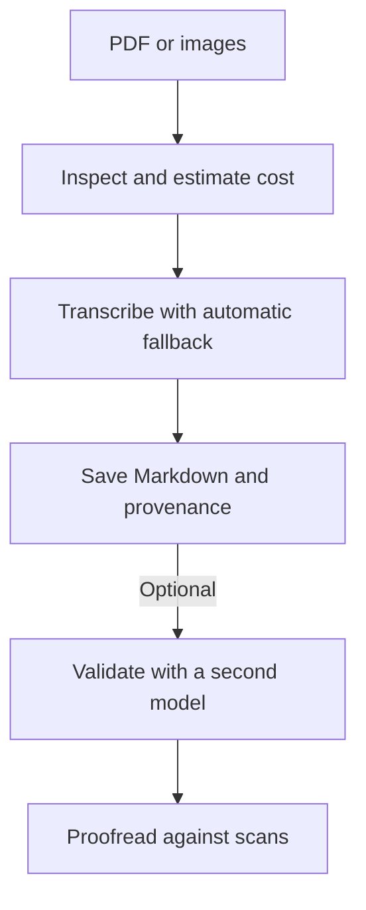

# transcriber

Faithful, checkable transcriptions of scanned archival documents (PDFs or photos taken in an archive) in any language or script, printed, typed or handwritten.

Each page image goes to a vision model through OpenRouter or a native provider API with a strict "faithful transcriber" prompt. A second, independent model checks the result. You then settle every disagreement in a proofreading app, with the scan beside the text.

Transcriber is a standalone command-line application. Use it directly, in scripts, on a remote machine, or through an AI agent; no particular agent or editor is required.



## Install and use

You need [uv](https://docs.astral.sh/uv/), which installs the Python dependencies on first use.

```sh
git clone https://github.com/tianyuf/archivist-transcribe transcriber
cd transcriber
uv run transcriber --help
```

A typical workflow is:

```sh
uv run transcriber auth login                      # sign in to OpenRouter in the browser (once)
uv run transcriber inspect letters.pdf --sample 1-3
uv run transcriber transcribe letters.pdf --language English
uv run transcriber validate letters.pdf            # second model + proofreading app
uv run transcriber models                          # recommended models and current prices
```

To make the `transcriber` command available outside the checkout, install it as an isolated uv tool:

```sh
uv tool install .
transcriber --help
```

On a remote machine without a browser, use `transcriber auth login --headless`. Automation can supply an OpenRouter key through the `OPENROUTER_API_KEY` environment variable instead of using the system keychain.

## Models and fallback

OpenRouter provides one account and API format for many model families. Convenient aliases include:

| Alias | OpenRouter model |
|---|---|
| `flash` | `qwen/qwen3.7-flash` (default) |
| `gemini` | `google/gemini-3.1-flash-lite` |
| `grok` | `x-ai/grok-4.3` |
| `openai` | `openai/gpt-6-luna` |
| `anthropic` | `anthropic/claude-haiku-5.5` |

Use `transcriber models` for the full alias list and current OpenRouter prices. Other image-capable OpenRouter IDs also work.

### Native provider APIs

Use `provider:model` to bypass OpenRouter and call a provider directly:

| Provider | Example | Environment credential |
|---|---|---|
| Google Gemini | `gemini:gemini-3.1-flash-lite` | `GEMINI_API_KEY` or `GOOGLE_API_KEY` |
| xAI Grok | `grok:grok-4.3` | `XAI_API_KEY` |
| OpenAI | `openai:gpt-6-luna` | `OPENAI_API_KEY` |
| Anthropic | `anthropic:claude-haiku-5-5` | `ANTHROPIC_API_KEY` |

For example:

```sh
export OPENAI_API_KEY=...
transcriber transcribe letters.pdf --model openai:gpt-6-luna
```

These are cost-first, stable vision-capable models, not automatic latest-model aliases or claims of best transcription accuracy. Pilot them on representative pages and choose a stronger model explicitly if necessary. Other native model IDs can be supplied, although their price estimates may be unavailable. Native credentials come from environment variables or Transcriber's system-keychain storage. If an Anthropic key is not scoped to a workspace, also set `ANTHROPIC_WORKSPACE_ID`.

To store a native key, use the provider name and enter the key at a hidden terminal prompt:

```sh
transcriber auth login --provider openai       # openai, grok, gemini, or anthropic
transcriber auth status --provider openai      # checks availability, not key validity
transcriber auth logout --provider openai
```

Environment variables take precedence over stored keys. Without `--provider`, `auth` manages OpenRouter through its existing browser/OAuth flow.

### Per-page fallback

Fallback is **enabled automatically**. You do not need to select one. Transcriber normally uses **Google Gemini through OpenRouter**, a non-Chinese model family. If that would duplicate the primary model, it selects a distinct OpenAI, Anthropic, or xAI model instead.

Override the automatic choice with `--fallback-model`, or disable it with `--no-fallback`:

```sh
transcriber transcribe letters.pdf --model flash --fallback-model gemini
transcriber transcribe letters.pdf --model openai:gpt-6-luna --fallback-model anthropic:claude-haiku-5-5
transcriber transcribe letters.pdf --model openai:gpt-6-luna --no-fallback
```

When a page exhausts the primary model's retries, or returns empty, truncated, repetitive, or explicitly refused output, Transcriber tries that page with the fallback. Other pages continue with the primary. Each selected model receives up to `--retries` attempts, and credentials for both providers are checked before the run starts. If neither produces a complete result, the longest visibly marked partial transcription is preserved when available.

A native primary still uses the automatic OpenRouter fallback by default, so both sets of credentials must be available. Use `--no-fallback` for a native-only run, or explicitly choose another native model.

Online validation also selects an automatic fallback for its B and C transcription runs. Override it with `--fallback-model` or disable it with `--no-fallback`; offline validation never invokes fallback. The actual model used for every page, total attempts, and fallback source are recorded in `run.json` and combined-document front matter.

Cost estimates show both the primary run and worst-case fallback use. `--max-cost` includes both and refuses to start if a selected model's price is unknown; retry charges can still exceed the estimate.

## Using with AI agents

Agent support is optional and separate from the CLI. All integrations use the same canonical workflow in `skills/transcriber/SKILL.md`; there are no copies to keep in sync.

| Environment | Integration |
|---|---|
| OpenCode | Discovers `.opencode/skills/transcriber`; its JavaScript plugin API is not needed |
| Codex | Reads `AGENTS.md` and `.agents/skills/transcriber`; root `plugin.json` follows the portable Agent Plugins format |
| Grok | Reads `AGENTS.md` and supports the Claude skill/plugin layout through its compatibility layer |
| Claude Code | Uses `.claude/skills/transcriber` and the optional `.claude-plugin/` marketplace adapter |
| Other agents | Use `AGENTS.md` or load `skills/transcriber/` through their Agent Skills support |

Plugin manifests and installation commands are not universally interchangeable. In particular, OpenCode's code plugins are different from Claude Code plugins; Transcriber needs only skill discovery there.

For Claude Code, the optional installation commands are:

```text
/plugin marketplace add tianyuf/archivist-transcribe
/plugin install transcriber@transcriber
```

## What it costs

You pay the selected provider directly for what you use. With the recommended OpenRouter model, **Qwen 3.7 Flash**, a typical page costs a small fraction of a cent, so a 300-page file comes to well under a dollar. Checking with a second model costs more, typically 2 to 10 times the transcription. The tool prints an estimate before every run, then reports OpenRouter charges and token usage for all providers. Native price estimates use standard rates checked on 2026-11-18; caching, long-context, priority, and future pricing tiers can differ. You can set an OpenRouter key limit when you sign in (`transcriber auth login --limit 10`) or a preflight estimate threshold per run (`--max-cost 2`).

## Privacy

Pages go to the selected model provider. OpenRouter forwards pages to the provider serving the chosen model; Qwen 3.7 Flash is served by Alibaba Cloud. Native model selections bypass OpenRouter and call Gemini, xAI, OpenAI, or Anthropic directly.

- **Restrict OpenRouter providers.** `--deny-data-collection` limits OpenRouter to providers that do not store or train on your data. Because Transcriber cannot enforce that policy through native APIs, the option rejects native primary or fallback models rather than silently weakening it.
- **Stateless native requests.** Gemini, OpenAI, and xAI calls set `store: false` to disable their optional conversation/response storage. This is not a claim of zero retention; Anthropic has no equivalent per-request setting.
- **Your keys stay local.** OpenRouter and native keys can be stored in your operating system's keychain (macOS Keychain, Windows Credential Manager, or Secret Service on Linux). Environment variables are also supported and take precedence. Keys are never written into your project folders or printed by the tool.

## Sources and options

A source can be a PDF, a single image, or a folder of photos (one photo per page, in natural filename order). Useful options for `transcribe`:

| option | for |
|---|---|
| `--profile printed` (default) / `handwritten` / `cjk` | printed or typed material in any language; manuscripts; Chinese, Japanese or Korean |
| `--language "German (Fraktur)"` | tells the model what to expect; always helps |
| `--notation cjk` | CJK markers (`□` `〔字〕`) with another profile, e.g. for Chinese manuscripts |
| `--layout lines` | keep every line break, for verse, registers and ledgers |
| `--diplomatic` | keep long s, ligatures and abbreviation marks as written |
| `--pages 1-3` | a pilot, or redoing particular pages (with `--force`) |
| `--dpi 200` | small or faint print (PDFs) |
| `-m 30b` | another model; see `transcriber models` |
| `--fallback-model gemini` | override the automatic non-Chinese fallback |
| `--no-fallback` | disable per-page fallback |
| `--estimate`, `--max-cost N` | know the cost before anything is sent |

Runs are resumable: every page is saved the moment it is done, so after an interruption you just rerun the same command.

## Python API

Python programs can use the public synchronous API instead of spawning the CLI:

```python
import transcriber

result = transcriber.transcribe_file("letters.pdf", language="English")
print(result.markdown, result.pages_done, result.pages_failed, result.models)

validation = transcriber.validate_file("letters.pdf")
print(validation.review, validation.merged, validation.flagged_pages)
```

`transcribe_file()` and `validate_file()` accept model and fallback options, including native `provider:model` IDs. Automatic fallback is enabled by default; pass `use_fallback=False` to disable it. Other options include page selection, output folders, workers, retries, DPI, privacy controls, and an optional provider-credential mapping.

Results are structured dataclasses containing output paths and status information. Configuration, credential, cost-limit, and fatal provider errors raise `TranscriberError`; individual failed pages are reported in `pages_failed`. Programs in other languages can invoke the CLI and consume the same Markdown, JSON, and HTML artifacts.

## Output

```text
output/letters.md                  all pages, with front matter recording source, models, prompt and dates
output/letters/pages/page_0001.md  one file per page
output/letters/run.json            which model and prompt produced each page, and when
output/letters.review.html         after validate: the proofreading app
output/letters.merged.md           after validate: the text with review markers
```

Review markers (editorial notation; the CJK notation is shown in brackets):

| marker | meaning |
|---|---|
| `[illegible]` (`□`) | the model could not read a word (character) |
| `[word?]` (`〔字〕`) | the model's best guess |
| `{A\|B}` (`〔A\|B〕`) | the two models read it differently |
| `{+B: …}` (`【补B:…】`) | a line only the second model saw; the first probably skipped it |

In the proofreading app you settle each marker by clicking a reading or typing a correction, then export the final Markdown. Your decisions are saved in the browser as you go, and can be exported and imported to continue on another computer.

## Why two models

There is no answer key for a scan, so the check is agreement between independent readers. In testing on archival material, one model occasionally dropped a whole line without any sign, while a stronger one tended to "correct" the source by modernizing spellings and fixing typists' errors. A faithful model as A and an independent model as B catch both kinds of error. A third model (`validate -c output-c`) can break ties on the pages that disagree.

## Development

```sh
uv run pytest     # offline: tests run against a mock of OpenRouter, including the sign-in flow
```

See `AGENTS.md` for how the code is organized.

## Licence

MIT; see `LICENSE`. It depends on PyMuPDF, which is AGPL-licensed: fine for running the tool yourself, but check its terms before offering it as a hosted service.
